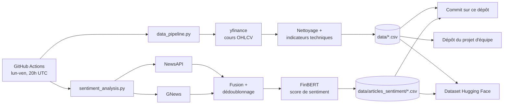

<div align="center">

# Stock Auto Update

**Pipeline automatisé de collecte de données boursières et d'analyse de sentiment financier**


[](https://huggingface.co/datasets/adam5858/stock-market-data)

</div>

---

## Présentation

Ce dépôt contient la partie **collecte et préparation des données** d'un projet académique de prédiction des marchés boursiers.

Chaque soir de semaine, un workflow GitHub Actions :

1. récupère les cours de **8 actifs** (actions et Bitcoin) sur les 2 dernières années,
2. calcule des **indicateurs techniques** prêts à être utilisés par un modèle de prédiction,
3. collecte les **articles de presse récents** sur chaque entreprise depuis deux API d'actualités,
4. analyse leur **sentiment financier** avec le modèle FinBERT,
5. publie les jeux de données mis à jour sur GitHub et sur **Hugging Face**.

Résultat : des données toujours à jour, harmonisées et versionnées, sans aucune intervention manuelle.

---

## Architecture



---

## 1. Données financières

Script : [`data_pipeline.py`](data_pipeline.py)

**Actifs suivis** : `AAPL` · `MSFT` · `GOOGL` · `AMZN` · `META` · `NVDA` · `TSLA` · `BTC-USD`

**Traitement appliqué**
- Récupération de 2 ans d'historique quotidien via `yfinance`
- Suppression des valeurs manquantes et des prix aberrants (cours nul ou négatif)
- Tri chronologique et format de date homogène (`YYYY-MM-DD`)
- Calcul des indicateurs ci-dessous, puis suppression des lignes incomplètes

| Variable | Description |
|---|---|
| `Open`, `High`, `Low`, `Close`, `Volume` | Cours et volume journaliers |
| `daily_return` | Rendement journalier |
| `volatility_10d` | Volatilité sur 10 jours (écart-type des rendements) |
| `MA_5`, `MA_20`, `MA_50` | Moyennes mobiles à 5, 20 et 50 jours |
| `RSI_14` | Relative Strength Index sur 14 jours |
| `volume_MA_5`, `volume_ratio` | Volume moyen sur 5 jours et volume relatif |
| `target_3d` | **Variable cible** : rendement du cours à 3 jours |

**Fichiers produits**
- `data/<SYMBOLE>.csv` : un fichier par actif
- `data/ALL_ACTIONS.csv` : tous les actifs réunis

---

## 2. Analyse de sentiment

Script : [`sentiment_analysis.py`](sentiment_analysis.py)

**Collecte des articles**
- Deux sources : [NewsAPI](https://newsapi.org) et [GNews](https://gnews.io)
- Articles des **3 derniers jours**, jusqu'à 8 par source et par entreprise
- Chaque article reçoit un identifiant unique (hash du titre, de la source et de la date) pour **éviter les doublons** d'un jour à l'autre

**Analyse**
- Modèle [`ProsusAI/finbert`](https://huggingface.co/ProsusAI/finbert), un BERT spécialisé dans les textes financiers
- Score de sentiment entre **-1 (négatif)** et **+1 (positif)**, avec un niveau de confiance
- Solution de secours par mots-clés financiers si le modèle ne peut pas traiter un texte
- **Pondération** de chaque article selon sa source et sa fraîcheur (les articles de moins de 24 h comptent davantage)

**Fichiers produits**
- `data/articles_sentiment/<SYMBOLE>.csv` : historique des articles par entreprise
- `data/articles_sentiment/ALL_ARTICLES_MASTER.csv` : tous les articles réunis

| Colonne | Description |
|---|---|
| `article_id` | Identifiant unique de l'article |
| `symbol`, `company` | Actif et entreprise concernés |
| `date_publication`, `source`, `api_source` | Origine de l'article |
| `titre`, `contenu`, `url` | Contenu de l'article |
| `score_sentiment`, `sentiment`, `confiance` | Résultat de FinBERT |
| `poids`, `score_pondere` | Pondération et score final |

---

## 3. Automatisation

Workflow : [`.github/workflows/update-daily.yml`](.github/workflows/update-daily.yml)

- **Déclenchement** : du lundi au vendredi à 20h UTC, après la clôture des marchés américains, ou manuellement depuis l'onglet *Actions*
- **Étapes** : installation de l'environnement, collecte financière, analyse de sentiment, puis publication
- **Publication** :
  - commit automatique des nouvelles données sur ce dépôt
  - copie des données financières vers le dépôt du projet d'équipe
  - mise à jour des datasets Hugging Face [`adam5858/stock-market-data`](https://huggingface.co/datasets/adam5858/stock-market-data) et `Projet4AIABoursiere/stock-market-data`

**Secrets GitHub nécessaires**

| Secret | Utilisation |
|---|---|
| `PUSH_TOKEN` | Push vers ce dépôt et vers le dépôt du projet |
| `NEWSAPI_KEY` | Accès à NewsAPI |
| `GNEWS_API_KEY` | Accès à GNews |
| `HF_TOKEN` | Publication sur Hugging Face |

---

## Lancer le projet en local

```bash
git clone https://github.com/adam-hassen/stock-auto-update.git
cd stock-auto-update

pip install yfinance pandas numpy scipy transformers torch requests huggingface_hub

# Données financières (aucune clé nécessaire)
python data_pipeline.py

# Analyse de sentiment (clés API nécessaires)
export NEWSAPI_KEY="votre_cle"
export GNEWS_API_KEY="votre_cle"
python sentiment_analysis.py
```

---

## Structure du dépôt

```
stock-auto-update/
├── .github/workflows/
│   └── update-daily.yml         # Automatisation quotidienne
├── data/
│   ├── <SYMBOLE>.csv            # Données financières par actif
│   ├── ALL_ACTIONS.csv          # Données financières réunies
│   └── articles_sentiment/
│       ├── <SYMBOLE>.csv        # Articles et sentiment par entreprise
│       └── ALL_ARTICLES_MASTER.csv
├── data_pipeline.py             # Collecte et indicateurs techniques
└── sentiment_analysis.py        # Collecte d'articles et analyse FinBERT
```

---

## Contexte

Ce pipeline alimente un projet académique de **prédiction des cours boursiers** mené en équipe, qui combine des modèles de séries temporelles (LSTM) et le sentiment issu de la presse financière. J'étais responsable de toute la partie données : collecte automatisée, harmonisation des sources, préparation des variables et publication des jeux de données.

> Projet réalisé à des fins pédagogiques. Les données et analyses ne constituent pas un conseil en investissement.

---

<div align="center">

**Adam Hassen** · [LinkedIn](https://www.linkedin.com/in/adam-hassen-06922b170/) · [Hugging Face](https://huggingface.co/adam5858) · [GitHub](https://github.com/adam-hassen)

</div>
